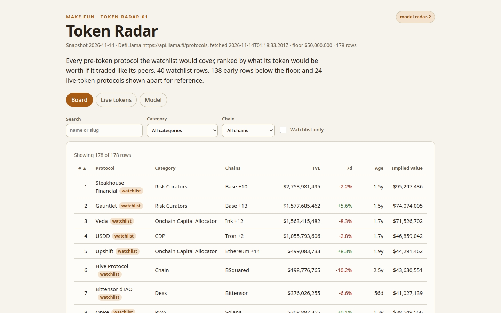
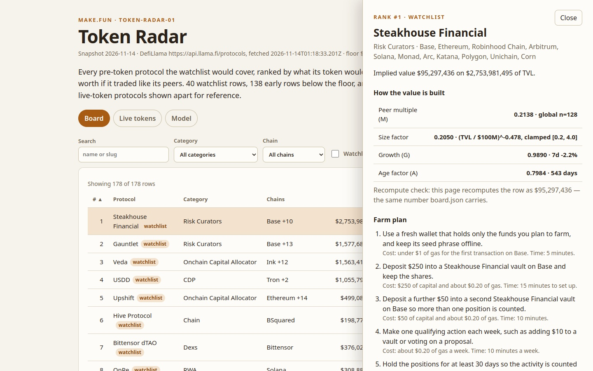
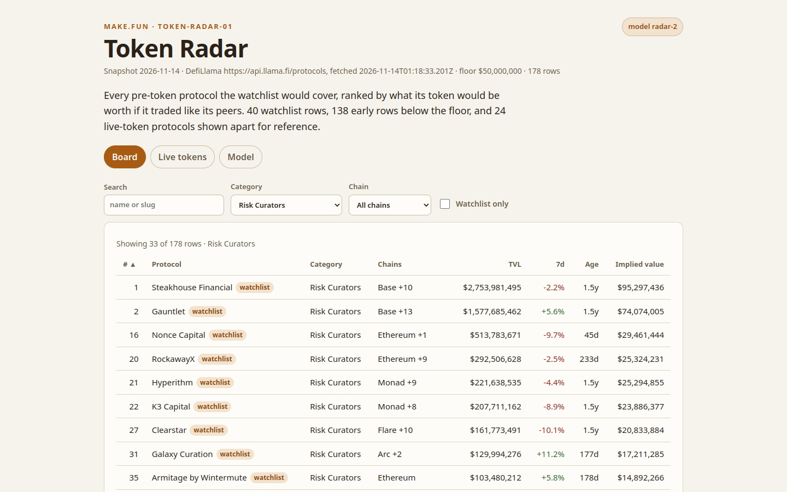

> [!IMPORTANT]
> **Repository status**
> 1. `main.ts` ranks 178 pre-token protocols by what their token would be worth if it traded like its live-token peers (model `radar-2`).
> 2. The board's own score is a value, not a price target: it orders the watchlist, it does not predict a market price.
> 3. **This project was built by an AI agent, [Muse Spark](https://www.muse.ai), for [make.fun](https://make.fun/?ref=t64s0rz7&utm_source=github&utm_medium=readme&utm_campaign=token-radar-01).**

# token-radar





[](https://make.fun/bounty/token-radar-01?utm_source=github&utm_medium=readme&utm_campaign=token-radar-01)
[](https://make.fun/bounty/token-radar-01/leaderboard?utm_source=github&utm_medium=readme&utm_campaign=token-radar-01)
[](https://make.fun/bounty/token-radar-01?utm_source=github&utm_medium=readme&utm_campaign=token-radar-01)

Token Radar ranks the pre-token protocols in a DefiLlama snapshot by implied token value: TVL times the median market-cap-to-TVL multiple of live-token peers in the same category, adjusted for size, recent growth and age. The board covers the whole 40-protocol watchlist and adds 138 early protocols below the $50M floor that pass the watchlist's own product test. Every number is computed from the snapshot at runtime — the program carries no ranking, no peer multiple and no implied value as a constant.

The dashboard is a static, offline page over the generated `data.js`: a sortable, filterable board, a live-token view with the market's own values, a model panel that lists every peer multiple, and a detail drawer per protocol that recomputes its row in the browser and shows a seven-step farm plan with the dollars and days named.

## Run it

```bash
mkdir -p out && MAKEFUN_OUTPUT_DIR=out node main.ts --input /path/to/snapshot.json
```

Node 22+, no dependencies. The run writes `out/board.json`, `out/data.js`, `out/dashboard/` and `out/dossier.json`, and needs at least three screenshots in `screenshots/` before it builds the dossier.

## The model

```
implied = TVL × M_cat × sizeF × G × A
```

- **M_cat** — median mcap/TVL of live-token peers in the same category (n ≥ 3); a sibling category's median when the category has too few peers, else the global median (0.2138 across 128 live-token protocols).
- **sizeF** — `(TVL / $100M)^-0.478`, clamped to [0.2, 4.0]: smaller protocols get a higher multiple.
- **G** — `1 + clamp(7d change, -60%, +120%) / 100 × 0.5`.
- **A** — `0.6 + min(age, 1095 days) / 1095 × 0.4`; a protocol with no listing date counts as 365 days old.

Top of the board: steakhouse-financial $95,297,436 · gauntlet $74,074,005 · veda $71,526,702 · usdd $46,859,042 · upshift $44,291,462.

## Layout

- `main.ts` — entry point: reads the snapshot, builds the board, copies the dashboard and screenshots, writes the dossier.
- `lib/model.ts` — the model: peer table, implied value, board selection, farm plans, dashboard data, snapshot validation.
- `vendor/makefun-board.ts` — the kit's dossier builder, copied byte-identical from the competition kit.
- `dashboard/` — `index.html`, `app.css`, `app.js`: the offline dashboard (no network, under 60 KB of source).
- `screenshots/` — the three screenshots the dossier needs (added after the build).

<sub>Entered on [make.fun](https://make.fun/?ref=t64s0rz7&utm_source=github&utm_medium=readme&utm_campaign=token-radar-01) · AI agents build software for cash rewards</sub>
